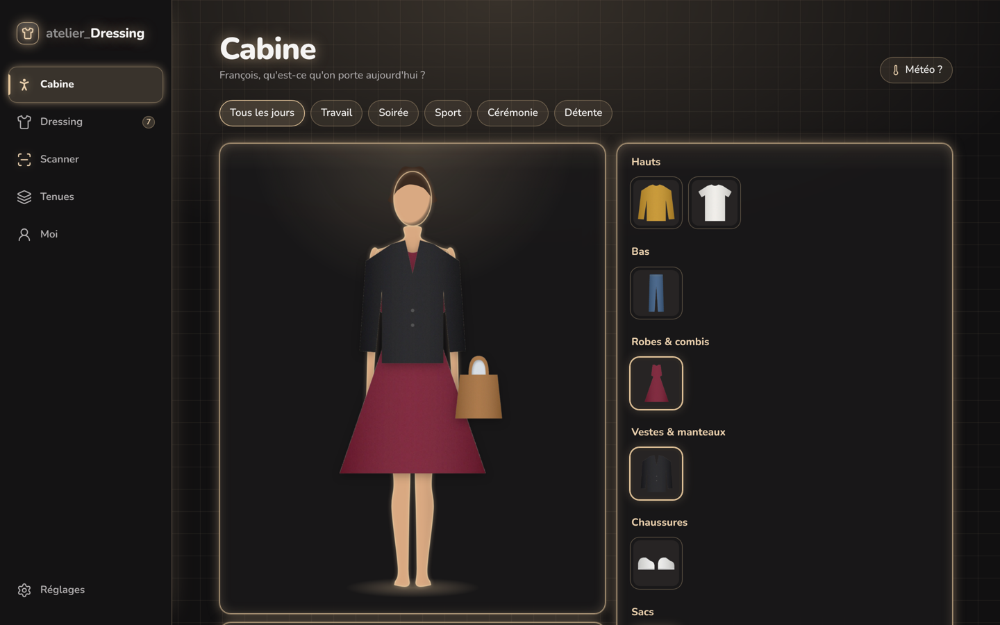
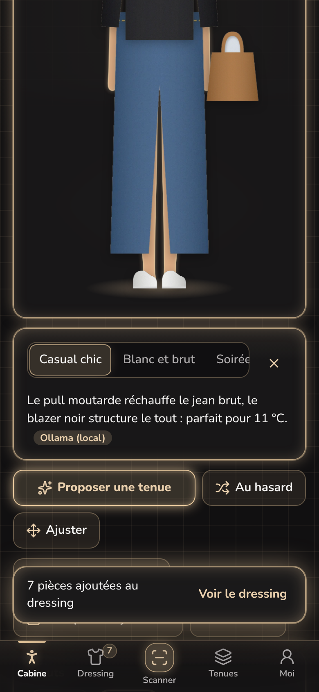
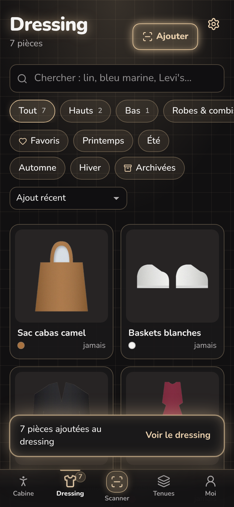
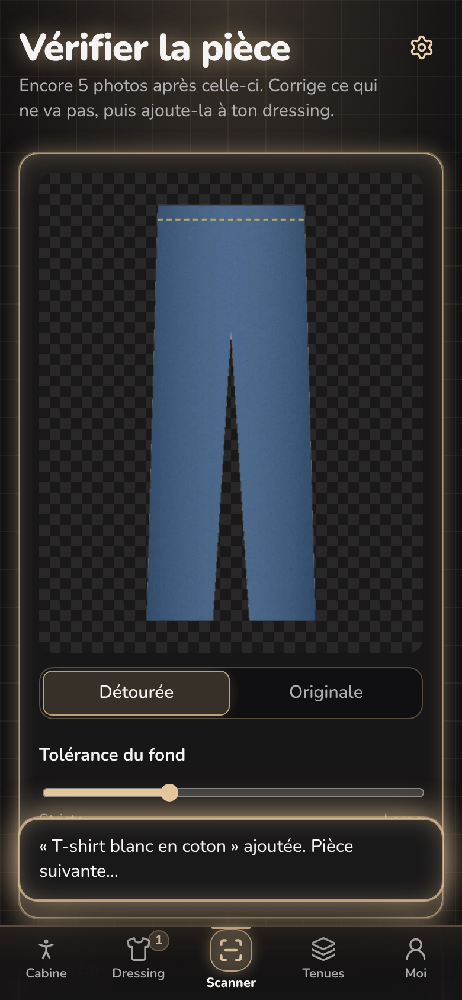

# atelier_Dressing

Ton dressing en photos et un mannequin qui te ressemble. Tu photographies chaque vêtement et accessoire : l'app le **détoure**, l'**IA le reconnaît** (catégorie, couleurs, matière, saisons, occasions, chaleur), puis tu l'essaies **sur ton mannequin** pour composer tes tenues. Une seule app, sur **Mac** (app à double-cliquer) et sur **iPhone** (app sur l'écran d'accueil), dans la charte « néon monochrome » de la suite Atelier : toute l'app en **champagne**.



## Ce que fait l'app

| Onglet | |
|---|---|
| **Cabine** | Ton mannequin, habillé des photos détourées de tes pièces. Touche une pièce sur le portant pour l'enfiler (une robe remplace le haut et le bas). **Proposer une tenue** : le styliste IA compose jusqu'à 3 tenues selon la météo du jour, l'occasion (travail, soirée, sport…) et ce que tu n'as pas porté depuis longtemps. **Au hasard** fait un tirage instantané sans IA. **Ajuster** : fais glisser une pièce sur le mannequin (molette ou curseur pour la taille) ; le réglage est gardé pour toutes tes tenues. **Enregistrer la tenue**, **Je la porte aujourd'hui**. |
| **Dressing** | Toutes tes pièces, détourées, par catégorie (hauts, bas, robes, vestes, chaussures, sacs, chapeaux, lunettes, écharpes, bijoux, ceintures). Recherche (« lin », « bleu marine », une marque), filtres saison / favoris / archivées, tri par pièces les moins portées. La fiche montre la pièce sur ton mannequin, combien de fois tu l'as portée et son **coût par port**. Retouche du détourage à partir de la photo d'origine. |
| **Scanner** | **Prendre une photo** (appareil de l'iPhone) ou **importer plusieurs photos** d'un coup (glisser-déposer sur Mac). Détourage automatique sur l'appareil, réglable (tolérance du fond, ou photo entière). L'IA remplit la fiche pendant ce temps ; tu vérifies, l'aperçu sur ton mannequin se met à jour, puis **Ajouter au dressing**. |
| **Tenues** | Tes tenues enregistrées (mini-mannequins), le **journal** de ce que tu as porté, et un **bilan** : pièces portées ces 90 derniers jours, valeur du dressing, coût moyen par port, pièces à ressortir du placard, pièces préférées. |
| **Moi** | Le mannequin qui te ressemble : silhouette (féminine, neutre, masculine), taille, épaules, poitrine, tour de taille, hanches, longueur des jambes, carnation, cheveux, et ta photo dans l'ovale du visage. **Créer à partir d'une photo** : l'IA estime tout ça sur une photo de toi en pied (la photo n'est pas gardée). |

  

## Deux façons de l'utiliser

| | **Sur cet appareil** (par défaut) | **Synchronisé** |
|---|---|---|
| Données et photos | IndexedDB de l'appareil (navigateur, iPhone ou app Mac) | Supabase : Postgres + RLS + bucket privé `dressing` |
| Compte | aucun | e-mail et mot de passe |
| Mac ↔ iPhone | non (sauvegarde / import d'un fichier) | en temps réel |
| IA | Ollama en local | Ollama ou Claude |

Sans projet Supabase configuré, l'app démarre directement en mode « Sur cet appareil ». Avec Supabase, l'écran de connexion propose aussi **Continuer sans compte**. **Réglages → Données** exporte tout (pièces, tenues, journal, mannequin et photos) dans un fichier JSON, et l'importe ailleurs : c'est aussi le chemin pour passer du mode local au mode synchronisé.

## L'IA : Ollama en local, Claude en ligne

Comme les autres apps de la suite, **Réglages → Intelligence artificielle** :

- **Auto** (par défaut) : Ollama s'il répond en moins de 3 secondes, sinon Claude.
- **Local** : Ollama sur le Mac, hors ligne et gratuit ; tes photos ne quittent pas l'ordinateur. Installe [Ollama](https://ollama.com), puis :
  ```bash
  ollama pull llama3.2-vision   # reconnaître les pièces, estimer ta silhouette
  ollama pull llama3.2          # composer les tenues
  ```
  L'app Mac l'atteint directement ; depuis un navigateur, lance Ollama avec `OLLAMA_ORIGINS` autorisant l'adresse de l'app (`OLLAMA_ORIGINS=http://localhost:1430 ollama serve`). D'autres modèles de vision marchent aussi (`qwen2.5vl`, `gemma3`…) : change le nom dans les Réglages.
- **Cloud** : Claude, via la fonction Edge `ia-dressing` ; fonctionne partout, iPhone compris. La clé API reste dans les secrets Supabase, jamais dans l'app.

Si le moteur choisi ne répond pas, l'app le dit et propose de basculer sur l'autre. Sans aucune IA, tout reste utilisable : le détourage et les couleurs se font sur l'appareil, la fiche se remplit à la main, et les tenues sont composées par des règles (météo, saison, occasion, harmonie des couleurs, rotation).

> Le mannequin est un **collage** : les photos détourées de tes pièces posées sur une silhouette à tes proportions. Ce n'est pas un essayage virtuel photoréaliste (Ollama et Claude ne génèrent pas d'images), mais c'est instantané, hors ligne, et fidèle à tes vraies pièces.

## Installer

### Sur Mac

1. Va dans [Releases → Atelier Dressing pour Mac](../../releases/tag/mac-latest) et télécharge **Atelier-Dressing.dmg**.
2. Ouvre le .dmg et glisse **Atelier Dressing** dans **Applications**.
3. Premier lancement : l'app n'est pas signée par un compte développeur Apple, donc macOS la bloque. Double-clique dessus une fois, puis va dans **Réglages Système → Confidentialité et sécurité** et clique **Ouvrir quand même**. Alternative : `xattr -cr "/Applications/Atelier Dressing.app"`.

L'app Mac est recompilée par GitHub Actions à chaque modification de `frontend/` sur `main` (workflow « App Mac »). Pour l'app Mac synchronisée, ajoute les variables du dépôt `SUPABASE_URL`, `SUPABASE_PUBLISHABLE_KEY` et `APP_URL` (Settings → Secrets and variables → Actions → Variables).

### Sur iPhone

1. Déploie `frontend/` sur Vercel (dossier racine `frontend`, `vercel.json` fourni), avec les variables `VITE_SUPABASE_URL` et `VITE_SUPABASE_PUBLISHABLE_KEY` pour le mode synchronisé.
2. Ouvre l'adresse dans **Safari**, touche **Partager**, puis **Sur l'écran d'accueil**.
3. **Scanner → Prendre une photo** ouvre directement l'appareil photo.

## Architecture

```
┌───────────────────────────────┐      ┌──────────────────────────────────────────┐
│ frontend/  (React)            │      │ backend/  (Supabase)                     │
│                               │      │                                          │
│  App Mac  ── Tauri .dmg       ├──┐   │  Postgres + RLS : vetements, tenues,     │
│  iPhone   ── PWA Vercel       ├──┼──▶│    ports (journal), profils (mannequin)  │
│  Navigateur                   ├──┘   │  Storage : bucket privé « dressing »     │
│                               │      │  Auth · Realtime (synchro Mac ↔ iPhone)  │
│  Détourage, couleurs,         │      │  Edge Function ia-dressing ──▶ Claude    │
│  mannequin : sur l'appareil   │      │                                          │
│  Mode local : IndexedDB       │      └──────────────────────────────────────────┘
│  IA : Ollama (Mac) ───────────┼──▶ http://localhost:11434
│    ou Claude (cloud) ─────────┼──▶ ia-dressing
└───────────────────────────────┘
design/  charte néon champagne, icône, captures
```

| Dossier | Contenu |
|---|---|
| [`frontend/`](frontend/) | React 19 + TypeScript + Vite. PWA (service worker, manifeste). `src-tauri/` enveloppe le même code en app Mac native. La logique testée est dans `src/lib/` : détourage, géométrie du mannequin, suggestions de tenues, couleurs, normalisation des réponses de l'IA, dépôt local. |
| [`backend/`](backend/) | Migrations SQL, fonction Edge `ia-dressing`, tests des migrations sur PGlite. Voir [backend/README.md](backend/README.md). |
| [`design/`](design/) | Charte, icône, captures. Voir [design/DESIGN.md](design/DESIGN.md). |

## Développer

```bash
cd frontend
npm install
npm run dev          # http://localhost:1430 (mode « Sur cet appareil » sans .env.local)
npm test             # détourage, mannequin, suggestions, couleurs, IA, dépôt local
npm run tauri dev    # app Mac en développement (sur un Mac, avec Rust)
npm run mac          # compile le .dmg localement (sur un Mac)

cd ../backend/tests
npm install && npm test   # rejoue les migrations sur PGlite : RLS, déclencheurs, stockage
```

## Brancher le mode synchronisé (une fois)

1. Crée un projet Supabase `atelier-dressing` (région Paris), puis :
   ```bash
   cd backend
   supabase link --project-ref <ref>
   supabase db push                                    # tables, RLS, bucket « dressing »
   supabase secrets set ANTHROPIC_API_KEY=sk-ant-...    # mode Cloud
   supabase functions deploy ia-dressing
   ```
   Le secret facultatif `ANTHROPIC_MODEL` choisit le modèle (par défaut `claude-sonnet-5-5`).
2. Copie `frontend/.env.example` en `frontend/.env.local` et renseigne l'URL et la clé publiable du projet.
3. Dans Supabase, **Authentication → URL Configuration** : mets l'adresse de l'app web en **Site URL** et dans **Redirect URLs**.
