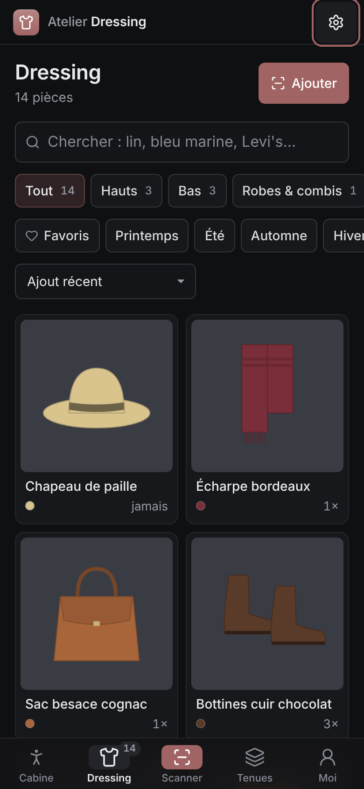
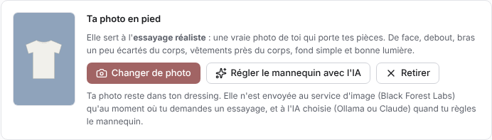
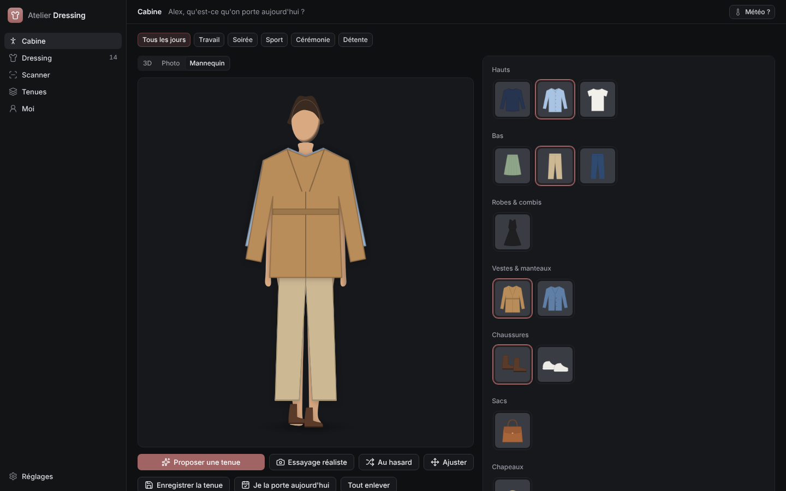

# Atelier Dressing — design UI

**Tâche principale de l'interface :** voir une tenue sur soi avant de l'enfiler, et retrouver n'importe quelle pièce du dressing en deux gestes.

## Direction : charte v2 « Linear » de la suite Atelier

Comme toute la suite (règles complètes : `Atelier_Deploy/DESIGN.md` ; résumé pour le code : `docs/SUITE.md` §1.7 d'Atelier_Projets), Atelier Dressing suit **un seul système commun** : structure neutre en gris froids, thèmes **clair et sombre**, dense, plat au repos, traits de 1 px, police **Inter** embarquée.

- **Signature vieux rose `#a16464`** (`data-atelier-app="dressing"`, déjà prévue dans la marque commune) : elle ne sert qu'à l'**accent** — bouton principal plein (texte blanc), sélection (voile de la signature), focus, liens, icône de l'app, cadre de la pièce qu'on ajuste. Rien d'autre n'est teinté.
- **Plat au repos** : pas de halo, pas de lueur, pas de grille de fond, pas de texte lumineux, pas de barre de couleur à gauche des éléments actifs. Une ombre seulement pour ce qui flotte : feuilles, toast, barre d'action, palette de couleurs, carte « Créer la 3D » posée sur la scène.
- **Thème** : préférence commune à la suite (Système · Clair · Sombre, Réglages → Apparence), posée avant l'affichage par `atelier-theme.js` ; l'ancien choix du Dressing (« Néon », « Clair », « Selon le système ») est repris une fois.
- **Couleurs littérales** alignées sur `--atelier-bg` : `#0f1012` (sombre) pour la fenêtre Tauri et le manifeste, `#fbfbfc` (clair) ; la balise `theme-color` suit le thème affiché.

Le kit commun `frontend/src/styles/atelier-brand/` (`atelier-brand.css`, `atelier-theme.js`, police Inter et sa licence) est une **copie exacte** des fichiers de la suite : ne jamais l'éditer ici. `tokens.css` branche les noms de jetons de l'app sur les jetons `--atelier-*`, `app.css` porte la base et la coquille, `dressing.css` ce qui est propre au dressing.

## Le contenu visuel mène

Les photos des pièces sont la matière de l'app ; l'interface autour reste neutre.

1. **Les photos détourées** sont posées sur un fond neutre uni (`--fond-photo` : gris très clair en clair, gris moyen en sombre pour que les pièces noires ou marine se lisent encore), sans cadre ni lueur. Le **damier** discret n'apparaît que là où la transparence compte (fiche, retouche, vérification).
2. **Le mannequin** : silhouette SVG à tes proportions, peau dans ta carnation, **contour fin et neutre**, ombre de contact au sol. Les pièces s'y posent en couches (chaussures, bas, haut, robe, ceinture, veste, écharpe, bijoux, sac, lunettes, chapeau) avec une ombre portée douce. La pièce qu'on ajuste est cerclée de pointillés dans la signature.
3. **La 3D** (vue par défaut de la Cabine) : le modèle tiré de ta photo d'essayage, sous une lumière de studio neutre (les couleurs des vêtements restent justes), avec une ombre au sol ; Face · Profil · Dos et rotation au choix (jamais lancée d'office). Tant qu'il n'existe pas, le mannequin reste affiché avec la carte « Créer la 3D » en bas de la scène ; pendant le calcul, un voile flouté dit l'étape en cours.
4. **Les pastilles de couleur** des pièces montrent la vraie couleur du vêtement, jamais la signature.

## Coquille

| | Ordinateur (≥ 860 px) | Téléphone (390 × 844) |
|---|---|---|
| Navigation | barre latérale de 232 px : marque (bouton « À propos »), Cabine, Dressing (compteur), Scanner, Tenues, Moi ; Réglages en pied ; entrée courante sur fond neutre | onglets en bas (icône dans une pastille neutre pour l'onglet courant ; le **Scanner**, action principale, dans une pastille pleine de la signature) |
| En-tête | l'en-tête de l'écran devient la **barre haute collante de 44 px** : titre en 13 px gras, sous-titre en gris, action à droite | bandeau du haut (marque + Réglages), puis le titre de l'écran (22 px) et son sous-titre |
| Densité | base 13 px, boutons de 30 px, champs de 36 px, filtres de 26 px, segmentés de 24 px | base 15 px, cibles tactiles de 44 px, champs en 16 px (pas de zoom sur iPhone) |
| Feuilles | dialogues centrés (520 ou 680 px) | feuilles qui montent du bas |

Contenu sur toute la largeur avec des gouttières de 20 px ; Cabine et Scanner en deux colonnes à partir de 980 px (le portant et l'aperçu restent collés sous la barre haute).

## Les 5 onglets

| Onglet | Icône Lucide | Contenu |
|---|---|---|
| **Cabine** | `PersonStanding` | tenue en 3D · Photo · Mannequin, portant par catégorie, occasion, météo, propositions de l'IA, ajustement, enregistrer / porter |
| **Dressing** | `Shirt` | grille des pièces, recherche, filtres, fiche avec aperçu sur le mannequin et coût par port |
| **Scanner** | `ScanLine` (mis en avant sur téléphone) | photo ou import multiple, détourage réglable, fiche pré-remplie par l'IA à vérifier |
| **Tenues** | `Layers` | tenues enregistrées, photos d'essayage, journal, bilan |
| **Moi** | `UserRound` | réglages du mannequin, photo en pied, création à partir d'une photo, visage |

## Principes

1. **On voit avant de lire.** Chaque pièce est montrée détourée, et dès que possible sur le mannequin (fiche, scanner, tenues).
2. **On vérifie avant d'enregistrer.** L'IA pré-remplit, on corrige : « Ajouter au dressing », « Enregistrer mon mannequin ».
3. **Rien ne dépend de l'IA.** Détourage, couleurs et tirage de tenues marchent hors ligne ; l'IA ajoute la reconnaissance et le styliste.
4. **Chaque action dit ce qu'elle fait**, et le toast reprend le même verbe.
5. **Témoin muet** : un service qui va bien (Claude, Ollama, jeton) n'affiche que son texte, en gris ; seuls les états anormaux sont colorés (`--atelier-warn`, `--atelier-down`).
6. **Accessibilité** : cibles de 44 px au doigt, focus visible (anneau de la signature), contrastes vérifiés, `prefers-reduced-motion` et `prefers-reduced-transparency` respectés, mannequin décrit pour les lecteurs d'écran (liste des pièces portées).

## Icône

Carré arrondi (rayon 22 %) en dégradé vertical de la signature, glyphe Lucide `shirt` blanc, comme toutes les apps de la suite. Source : [`icone/icone-carre.svg`](icone/icone-carre.svg) (copie de `frontend/public/icone.svg`) ; PNG de l'app : `node frontend/scripts/icones.mjs` ; `icone/icone-1024.png` est la version à la grille macOS (carré de 824 px avec ombre) dont sont tirées les icônes Mac : `npx tauri icon design/icone/icone-1024.png -o src-tauri/icons` (puis ne garder que les fichiers déjà présents).

## Captures

Données de démonstration fictives (vignettes de vêtements dessinées, aucune photo de personne).

| iPhone | | |
|---|---|---|
|  |  |  |
|  |  |  |
|  |  |  |

**Ta photo en pied** pour l'essayage réaliste

**Mac**

