# atelier_Dressing — design UI

**Tâche principale de l'interface :** voir une tenue sur soi avant de l'enfiler, et retrouver n'importe quelle pièce du dressing en deux gestes.

## Direction : néon monochrome (charte v2 de la suite Atelier)

Comme Projets, Viz, Tab, Ciné, Trésorerie, Savoir, Nexus, Dates et Cuisine, **toute l'app est dans sa couleur signature** : un **champagne** (soie, couture, étiquette dorée), `#E6C79C` en néon et `#9C7643` en clair (texte `#0B0B0F` posé dessus à 4,8:1). Fond, barre latérale, verre, traits, halos et grille en dérivent.

- **Néon (défaut)** : fond quasi noir teinté de champagne, fine grille, panneaux de verre cerclés d'un trait lumineux, mannequin au contour néon sous un projecteur de cabine d'essayage.
- **Clair** : fond très clair teinté, cartes blanches cerclées de champagne, action principale pleine.

Le kit commun `frontend/src/styles/atelier-brand/atelier-brand.css` est une copie exacte du fichier de la suite (ne jamais l'éditer ici). Le kit ne prévoit pas encore de signature pour Dressing : `tokens.css` la pose sur `:root[data-atelier-app="dressing"]`, avant que le kit n'en dérive le reste. À la prochaine mise à jour du kit, ajouter `--atelier-sig-dressing: #e6c79c` à la source.

Couleurs littérales alignées sur `--atelier-bg` : `#141312` (néon) pour la fenêtre Tauri, le `theme-color` et le manifeste ; `#f6f4f4` en clair.

## Matières propres au dressing

1. **Le mannequin** : silhouette SVG à tes proportions, peau dans ta carnation, **contour néon champagne**, lueur au sol. Les pièces s'y posent en couches (chaussures, bas, haut, robe, ceinture, veste, écharpe, bijoux, sac, lunettes, chapeau) avec une ombre portée douce.
2. **La cabine** : panneau de verre avec un projecteur champagne en haut.
3. **Le damier** sous les photos détourées, discret, pour voir la transparence.
4. **Les pastilles de couleur** des pièces : la vraie couleur du vêtement, jamais la signature.

## Les 5 onglets

| Onglet | Icône Lucide | Contenu |
|---|---|---|
| **Cabine** | `PersonStanding` | mannequin habillé, portant par catégorie, occasion, météo, propositions de l'IA, ajustement, enregistrer / porter |
| **Dressing** | `Shirt` | grille des pièces, recherche, filtres, fiche avec aperçu sur le mannequin et coût par port |
| **Scanner** | `ScanLine` (mis en avant dans la barre) | photo ou import multiple, détourage réglable, fiche pré-remplie par l'IA à vérifier |
| **Tenues** | `Layers` | tenues enregistrées, journal, bilan |
| **Moi** | `UserRound` | réglages du mannequin, création à partir d'une photo, visage |

Mise en page : barre d'onglets en bas sur iPhone, barre latérale de 248 px sur Mac ; contenu jusqu'à 1120 px de large sur grand écran (cabine et portant côte à côte), feuilles qui montent du bas sur iPhone et dialogues centrés sur Mac.

## Principes

1. **On voit avant de lire.** Chaque pièce est montrée détourée, et dès que possible sur le mannequin (fiche, scanner, tenues).
2. **On vérifie avant d'enregistrer.** L'IA pré-remplit, on corrige : « Ajouter au dressing », « Enregistrer mon mannequin ».
3. **Rien ne dépend de l'IA.** Détourage, couleurs et tirage de tenues marchent hors ligne ; l'IA ajoute la reconnaissance et le styliste.
4. **Chaque action dit ce qu'elle fait**, et le toast reprend le même verbe.
5. **Accessibilité** : cibles de 44 px, focus visible, contrastes vérifiés, `prefers-reduced-motion` et `prefers-reduced-transparency` respectés, mannequin décrit pour les lecteurs d'écran (liste des pièces portées).

## Icône

Cintre champagne lumineux avec son étiquette, dans le carré arrondi au cadre chromé de la suite. Source : [`icone/icone-carre.svg`](icone/icone-carre.svg) (copie de `frontend/public/icone.svg`) ; PNG de l'app : `node frontend/scripts/icones.mjs` ; icônes Mac : `npx tauri icon design/icone/icone-1024.png -o src-tauri/icons`.

## Captures

| iPhone | | |
|---|---|---|
| 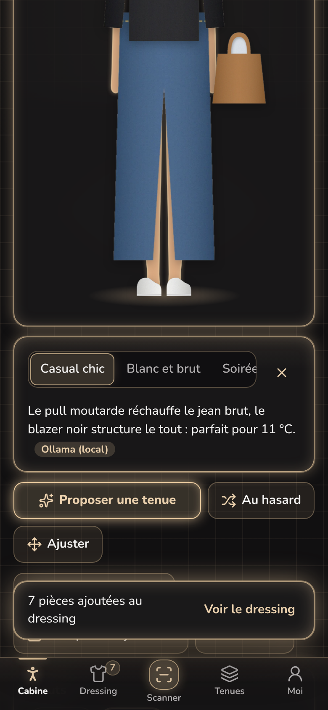 | 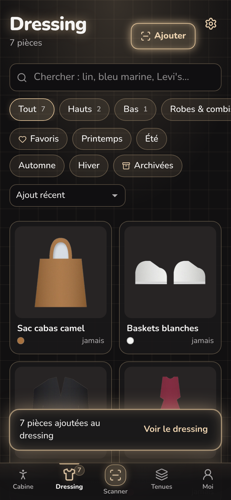 | 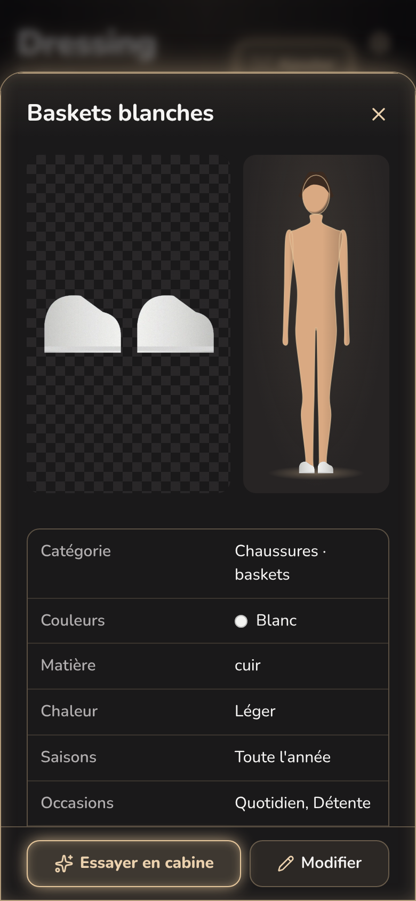 |
| 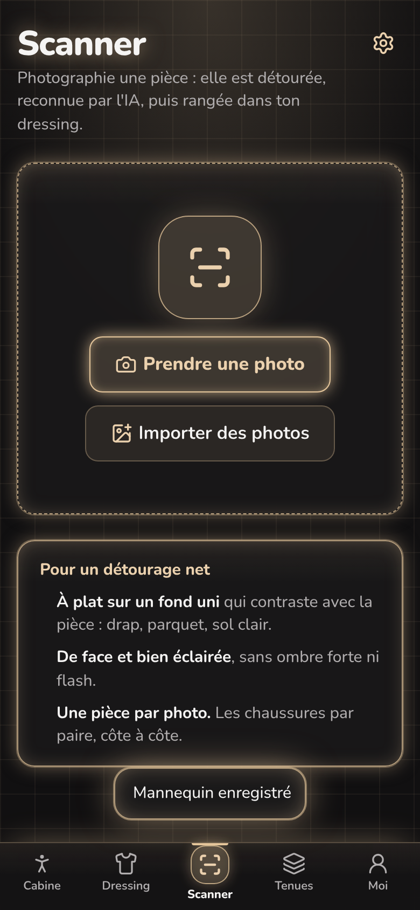 | 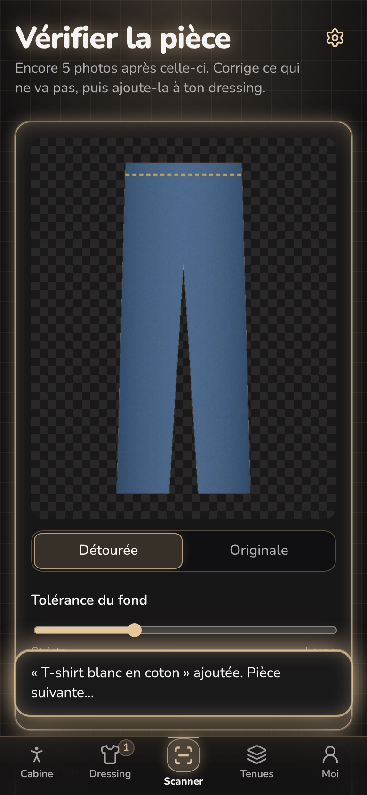 | 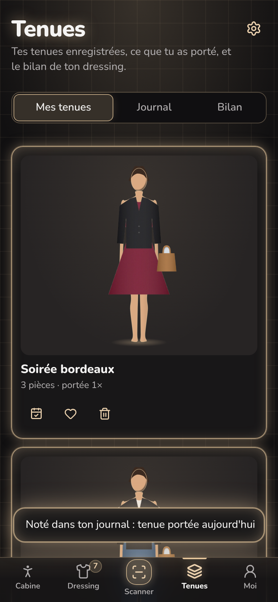 |
| 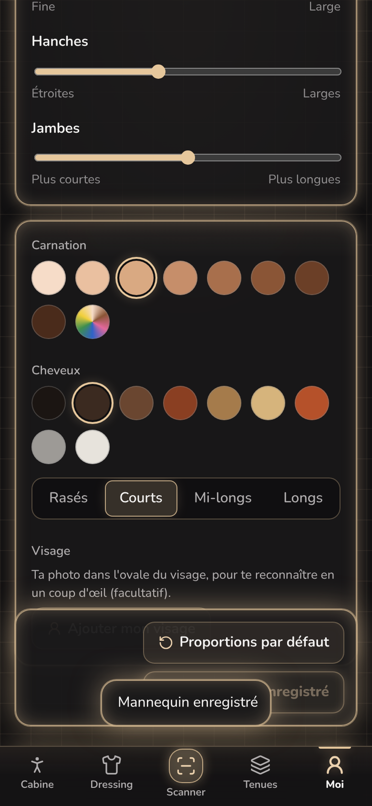 | 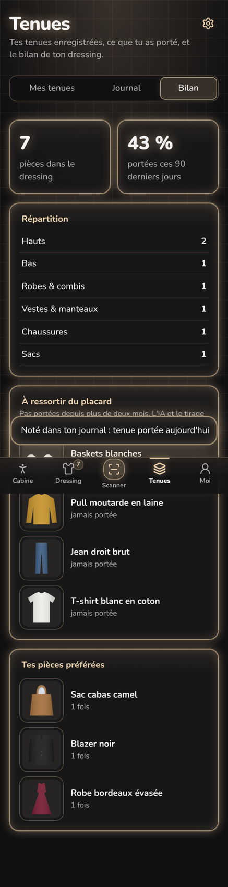 | 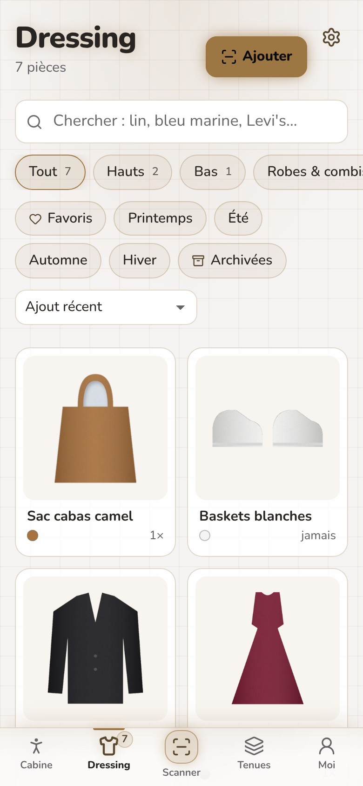 |

**Mac**

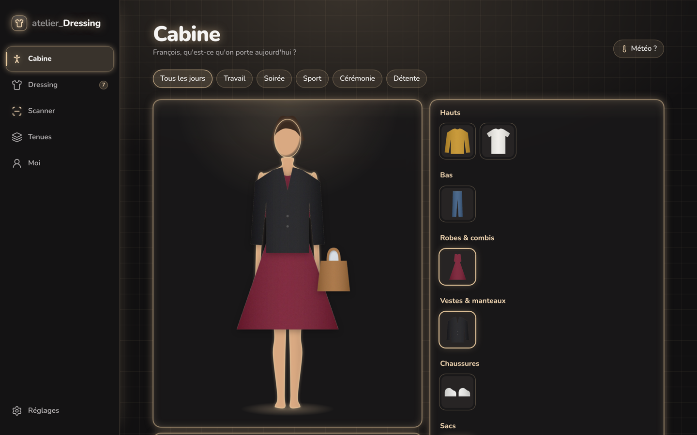
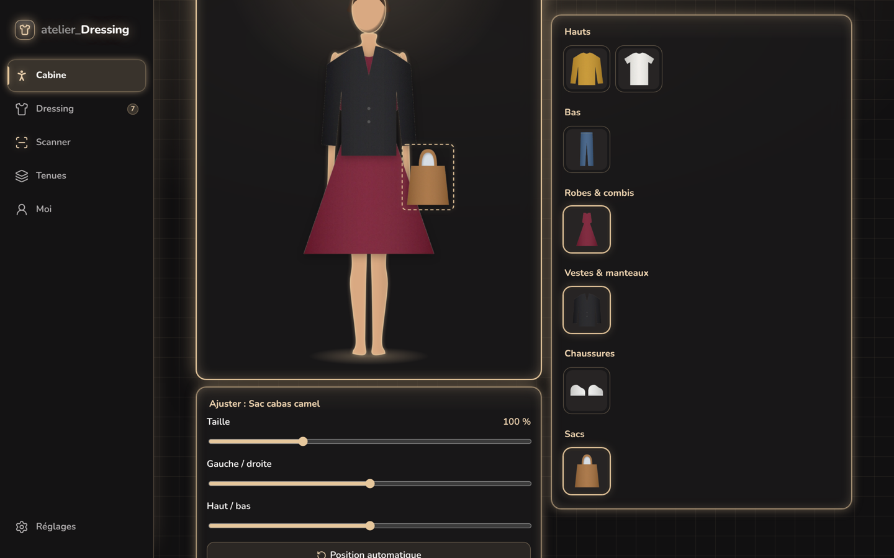
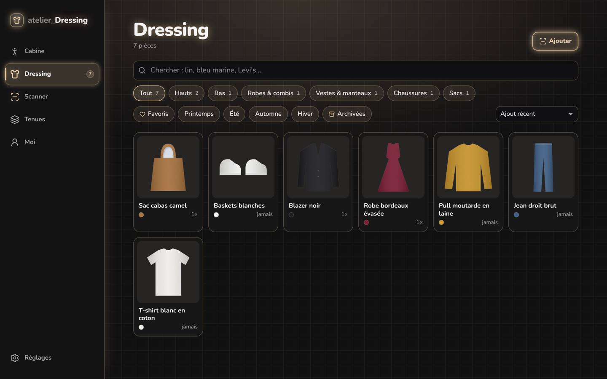
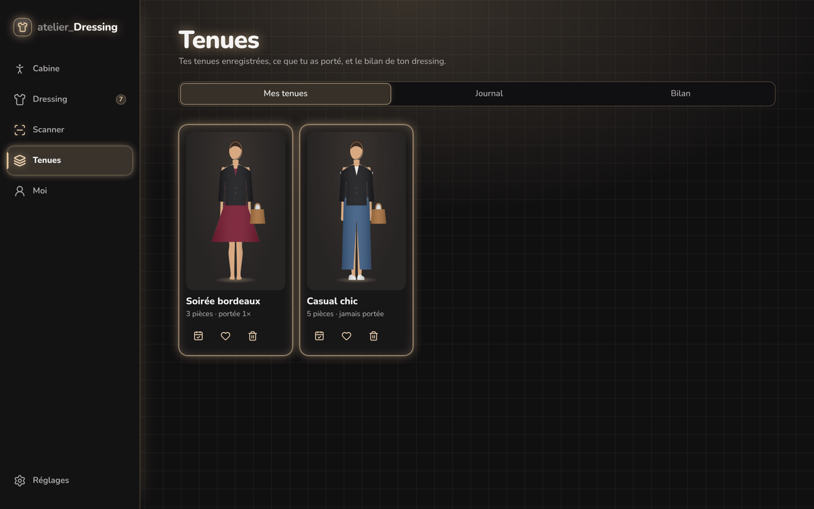
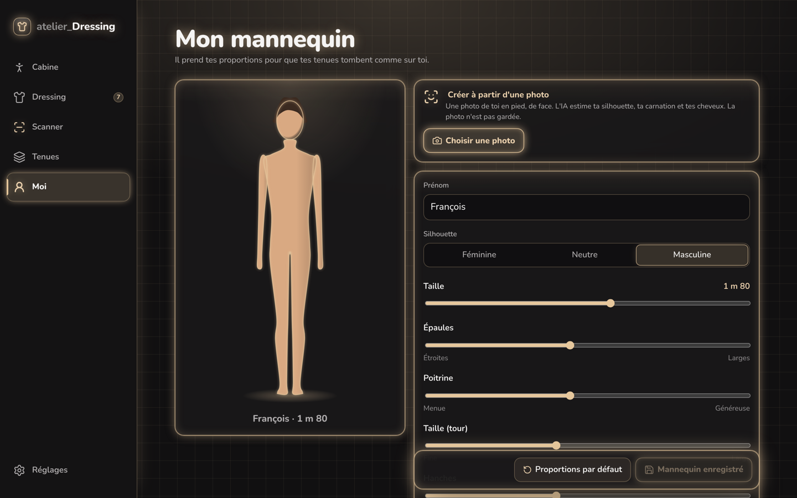
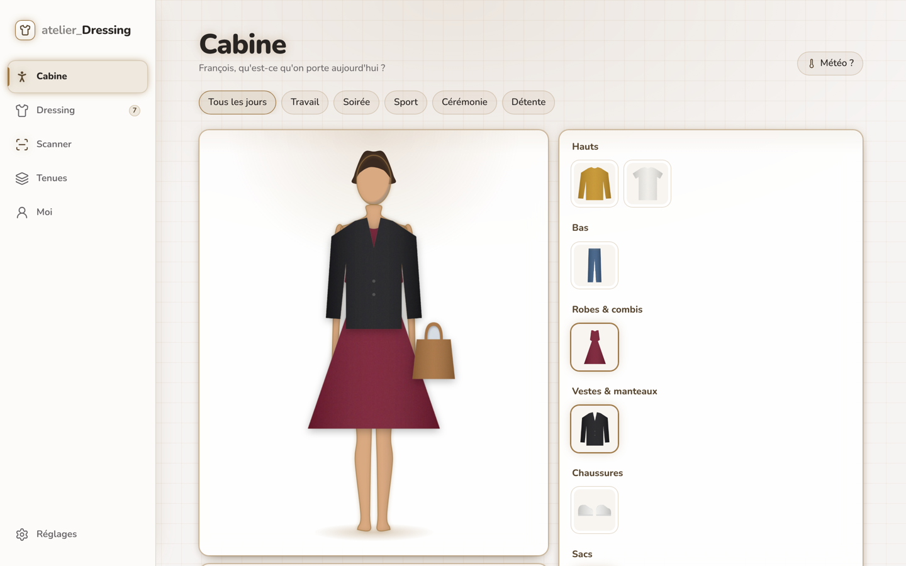
